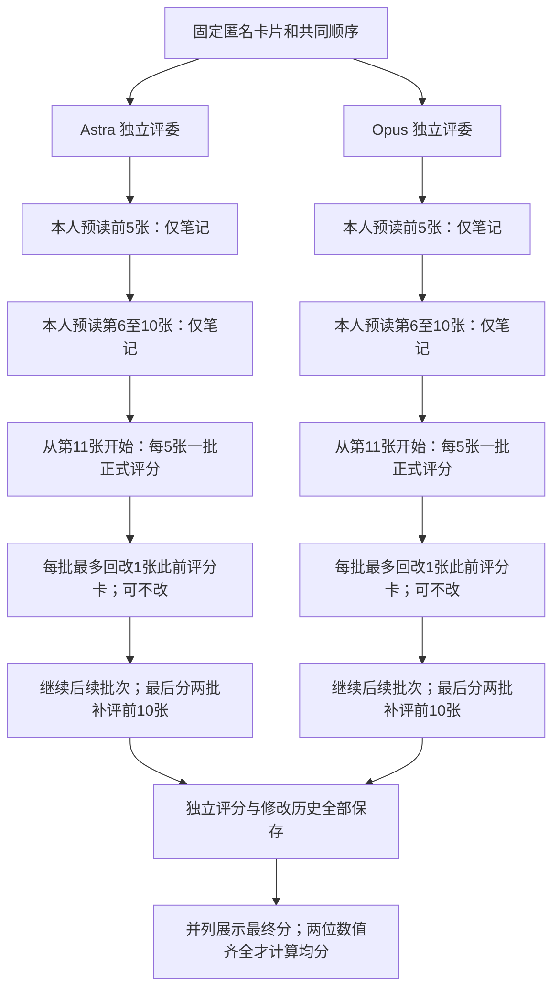

# 独立多模型循环阅卷 v1

本协议是新试验，不替换默认135条冻结集，不复用旧 panel 或单卡评分。

## 已实现流程



- 每位评委仅一轮，多次调用是本轮内部阶段。两位评委可并行；同一评委的阶段严格串行。
- 前10张不评分、不排名；不足5张的尾批仍是一个评分loop。
- 后续新卡评完后，补评第1–5张、第6–10张；这两批也各允许最多回改1张之前已评分卡。末批之后直接结束。
- 一张旧卡可被不同loop再次修改；同一loop不能修改两张卡，也不能把刚首次评分的卡作为回改对象。
- 首次评分需达到最终交付标准，不能依赖日后改分。不要求必须修改，不设排名配额，不强迫分布。
- 修改需完整提交八维评分、旧判断偏差、当前loop触发卡片、被修改卡的逐字原文证据。至少一个维度分数实际改变；总分程序重算。
- “严格公平”“不暗中给预读卡打分”是提示词中的语义要求；程序不能验证模型未输出的内部思考。程序强制预读不提交assessment/revision，笔记禁止额外score字段，但不声称能证明所有文字理由公平。

## 上下文与独立性

每次请求新建会话，显式重放该评委自己的所有阅读笔记、尺度笔记、评分账本、修改历史，以及已见卡片原文。当前批次有完整原文；未来卡片不提供。不存在原生会话隐式续接或跨评委共享记忆。

评委只见匿名卡片、任务上下文、领域、约束、已有参考材料及本人状态；系统映射只用于报告。要求禁止工具/联网：Astra返回工具调用即拒收，Opus CLI使用空工具与空MCP配置。

Astra请求 gpt-6-astra/high；Opus请求 claude-opus-5-5/high。模型名称是请求身份，不独立保证网关上游实现。模型名单写入冻结配置，禁止退化为两个同模型实例。

随着卡片增加，完整原文与账本会扩大请求体；v1不静默裁剪、不自动摘要丢弃旧卡。超出上下文或网关失败时停在当前阶段，不伪造评分。扩大到大批次前需单独设计上下文预算。

## 时间、失败与恢复

预读每阶段45分钟；评分/补评每阶段90分钟；CLI结束/清理预留35秒。这是本地阶段预算，不保证外部网关允许同样长的连接；Opus沿用现有传输适配器，内部API请求超时仍为15分钟，可能提前失败。

每次执行每个未完成阶段最多一个新尝试，无自动失败循环。失败不推进账本，整阶段通过校验后才接受。显式 `--retry-failed` 才允许再尝试历史失败阶段。检测到尚未核实退出的running尝试则阻止续跑。成功阶段复用且重验上下文哈希，不能重采样覆盖成功评分。

accepted.json是阶段提交记录，state.json可从所有提交顺序重建；中断在提交与状态写入之间也能恢复。每位评委只读本人阶段记录。报告含首次分、最终分与全部改分记录，不混入旧协议分数。

## 试验批次与使用

默认30卡，6道共同任务×5系统：028、032、001、007、010、017。保留旧试验028/032，新增4个不同领域任务。任务选择不使用分数排名；来源是已冻结五组共同22题中的材料，因此属于成功共同子集，不代表完整生成成功率。

前10张为028/032的五系统全部卡片，固定随机打散；其余20张另行固定打散。两个模型使用完全相同的顺序。前10张仍只有两个任务，可能影响尺度，不能声称无顺序或领域锚定偏差。

30卡每位评委8次阶段调用（2预读＋4新卡评分＋2补评），两模型计划16次调用、60份最终评分；失败重试另计，不是费用估计。

```bash
# 只准备材料与空报告；不调用模型
python3 -m idea_benchmark.panel.sequential prepare
# 真正调用两种模型；运行前确认凭证/额度可用
python3 -m idea_benchmark.panel.sequential run
# 仅运行指定评委
python3 -m idea_benchmark.panel.sequential run --judge opus
# 显式补试已失败阶段，每阶段一次
python3 -m idea_benchmark.panel.sequential run --judge opus --retry-failed
# 不调用模型，只重新生成报告
python3 -m idea_benchmark.panel.sequential report
# 离线行为测试
python3 -m unittest idea_benchmark.panel.test_sequential -v
```

另选材料使用 `prepare --out 新目录 --source 来源目录 --tasks ...`，至少三道完整五系统任务；旧冻结目录拒绝覆盖。源输入/正文哈希校验，协议prompt、模型配置、顺序、卡片与代码哈希冻结，执行前重新校验。

## 统计解释

七维总分沿用试验权重N .25、P .10、I .15、S .25、F .10、E .10、C .05；Interesting独立。任一加权维不可评则总分不可评。只有两位都有数值才给双评委均分，缺项不填零。均分不代表共识，跨模型一致不等于科学正确。

不新增单卡评审队列；旧单卡对照保留原处。新协议模型/effort/材料规模变化，不能将旧单卡分差直接归因为循环阅卷。若开展严格方法对照，应另做同模型同材料同effort的单卡组。
